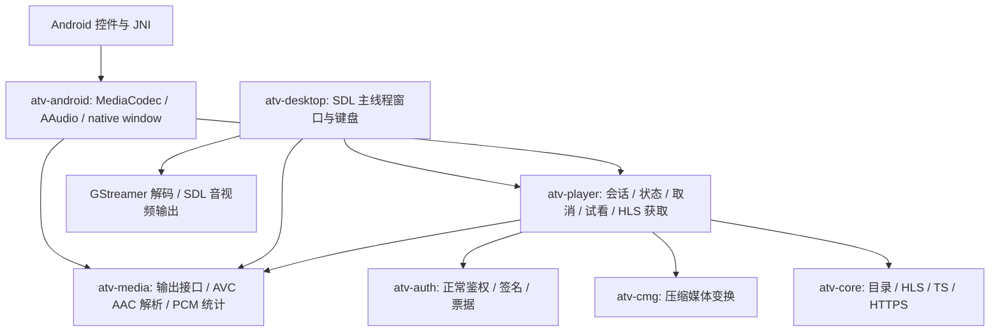

> 2026-10-16 更新：Apple 五个目标已通过真实 Xcode CI 编译；Linux x86_64 / ARM64 原生宿主、Android 通用及四个单 ABI 包、三系统共享核心检查也已通过。Apple 设备安装与播放仍未验收，见 [apple-native.md](apple-native.md)。Android API 19／32 位兼容范围见 [android-kitkat.md](android-kitkat.md)。下文早期运行记录保留原有证据范围。

# 多平台原生架构

更新：2026-10-16。多平台实现已合并到 `main`。原开发分支 `feature/multiplatform` 从已经完成 Android 原生
验收的 `feature/rust-native` / `8538fbb` 创建。基线 `9f20444` 以历史标签保留，两个开发分支均已合并。
默认 Android 工程已迁到根目录 `app/`，详见 [默认构建迁移](main-native-build.md)。本次把共享引擎从 Android crate 中拆出，并以 Linux 原生
窗口、解码和音频输出证明其可复用；不宣称已经交付所有平台的完整应用。

## 依赖方向



`atv-player`、`atv-media`、`atv-core`、`atv-auth`、`atv-cmg` 是共享库。
它们不引用 JNI、Android 窗口、平台 codec、SDL 或 GStreamer。平台后端
依赖共享接口，共享引擎不依赖某个平台后端。原来的 `identity.rs`、
`playback.rs` 和播放循环已迁移到 `atv-player`；SPS / ADTS / Annex B /
PCM 测量和输出契约在 `atv-media`。频道快照也独立放入 `atv-core/assets/`，
不再通过相对路径编译引用旧网页目录。Android 保留相同元数据副本，边界
检查会校验两者一致。

## 共享接口与线程

- `MediaOutput`：接受规范化 PTS 的 AVC Annex B / AAC ADTS，处理背压，
  `drain` 返回实际图像提交与音频输出接受量。接受压缩包不等于已播放。
- `OutputFactory`：在拥有播放输出的线程上创建输出，切台／不连续时重建。
  工厂本身持有窗口或设备资源，引擎保证先销毁输出，再销毁工厂。
- `Player<F>`：由宿主主线程反复调用 `tick`，通过 `select/pause/resume/stop`
  控制。接口不强制 `Send`，可以安全使用 SDL 等要求主线程拥有窗口的 API。
- `Session`：在独立 render 线程运行同一个 `Player` 的控制包装，要求工厂
  可移动到工作线程，输出本身始终不跨线程。Android 使用此方式，JNI 仅
  转换参数和句柄。
- `LiveSource`：正常鉴权／下载提供者接口；生产实现仍是同一个
  `LiveResolver` 与 Rust HLS 获取流程。引擎统一管理取消、旧会话隔离、
  全进程最多两个下载工作任务、双轨推进判断、试看和到期限制。

所有平台都必须先经过正常服务端授权，再进行 CMG 和解码；设备身份由
宿主提供的持久私有目录保存。Android 目录仍为 `getFilesDir()`，桌面目录
由 SDL 的平台 preference-directory API 决定。切台与后台恢复不轮换身份。
未观察的远端 JS challenge 和原有格式边界保持明确失败。

## 库的选择

| 职责 | 依赖 | 本次处理 |
| --- | --- | --- |
| HTTPS / TLS | reqwest 0.12 + rustls | 已有跨平台库，保留；workspace 统一 features，关闭默认 TLS，避免引入 OpenSSL／Java HTTP 客户端 |
| JSON / URL / 错误 | serde / serde_json / url / thiserror | 已有跨平台库，保留并统一 workspace 版本 |
| AES / CBC / CTR / MD5 | RustCrypto 对应 crate | 保留 Rust 实现；共享签名、票据和媒体处理不依赖 OS 加密 API |
| 解复用 / CMG / 状态 | 本项目 Rust 共享库 | 从 Android crate 移出，不引入 WASM 或解释器 |
| 桌面压缩媒体解码 | GStreamer 0.24 Rust bindings，运行库至少 1.20 | 实际使用 appsrc / appsink；只负责解码，不获取直播地址或访问网络 |
| 桌面窗口／键盘／音频 | SDL2 0.38 Rust bindings | 原生窗口、纹理与 PCM queue；同一主线程拥有输出 |
| Android 解码／输出 | NDK MediaCodec / AAudio | 保留为平台后端，以继续使用 Android 系统解码能力；不会污染其他平台依赖树 |

GStreamer 官方提供多平台部署支持，但部署时仍需各平台的运行库与插件，
不等于只复制 Rust 可执行文件就能在所有机器运行。
参考：[GStreamer deployment](https://gstreamer.freedesktop.org/documentation/deploying/index.html)、
[appsrc 输入与队列契约](https://gstreamer.freedesktop.org/documentation/app/appsrc.html)、
[SDL AudioQueue](https://docs.rs/sdl2/0.38.0/sdl2/audio/struct.AudioQueue.html)。
没有为“所有库名字都一样”而删除已经验证的 Android 原生硬件接入。

## 构建与运行

共享核心不需要 Android SDK，也不需要 SDL / GStreamer：

```sh
cargo test --locked --manifest-path native/Cargo.toml \
  -p atv-core -p atv-auth -p atv-cmg -p atv-media -p atv-player
python3 scripts/check-native-architecture.py
```

`native/rust-toolchain.toml` 固定 Rust 1.99.1。当前机器的非默认工具链路径由
构建脚本识别；其他机器可使用标准 rustup/cargo。workspace 默认成员不含
桌面宿主，因此默认核心构建不会要求桌面多媒体开发 SDK。

Linux 桌面需 SDL2、GStreamer 的开发库，以及运行时 base/good/bad/libav
插件（`h264parse`、`aacparse`、AVC/AAC decoder）。例如 Ubuntu/Debian：

```sh
sudo apt-get install libsdl2-dev libgstreamer1.0-dev libgstreamer-plugins-base1.0-dev \
  gstreamer1.0-plugins-base gstreamer1.0-plugins-good gstreamer1.0-plugins-bad gstreamer1.0-libav
./scripts/native-desktop.sh
./scripts/native-desktop.sh --channel CCTV2
./scripts/native-desktop.sh --build-only --release
```

输出 `native/target/release/atv-desktop`。也可以直接使用
`cargo run --locked --manifest-path native/Cargo.toml -p atv-desktop`。
方向键左／右切台，Enter 切换全屏，Escape 退出全屏，P 暂停／恢复，R
重试，Q 退出。桌面目前是最小原生验证宿主：频道名、播放状态和错误在窗口
标题显示，频道选择通过键盘或 `--channel`，尚未提供完整图形频道侧栏。

本机系统缺少 good/libav 插件，已从 Arch 官方 archive 下载匹配系统版本
的签名包，`pacman-key` 验签后仅提取 `libgstaudioparsers.so` 和
`libgstlibav.so` 到 `${HOME}/.local/share/atv-desktop/plugins`。
脚本仅为当前进程设置 `GST_PLUGIN_PATH`，没有修改系统包或全局配置。
其他机器正常安装插件包即可，不需要使用这个本机目录。

Android 继续独立构建：

```sh
./scripts/native-android-build.sh
```

仅构建 `atv-android` 及共享库；APK 不携带 SDL / GStreamer 或其插件。
原 JNI 六个方法、应用 ID 与 Java 原生界面保持兼容。

## 验证与平台状态

| 平台／层 | 当前证据 | 尚未证明的部分 |
| --- | --- | --- |
| 共享 Rust 核心 | 本机 Linux 编译、50 项普通测试、严格 Clippy；新增 5 项生命周期／线程／背压策略测试 | 不用脚本化输出测试冒充实际播放 |
| Android | arm64-v8a / x86_64 构建、lint、无 JS/WebView/WASM 的 APK 检查；重构版真实 smoke 通过 | 实体电视／物理硬件解码仍未测试 |
| Linux 桌面 | GStreamer + SDL 真正解码、绘制、输出 PCM；120 秒直播记录与独立进程音频流采样，见下文 | 完整桌面频道侧栏、安装包分发和更广泛硬件覆盖 |
| Windows | 共享核心测试、Clippy 与架构检查已在远端 CI 通过 | 尚无 Windows 桌面宿主 |
| macOS / iOS / tvOS | 已实现 Swift/AVFoundation 宿主；五目标实际 Xcode 编译及应用归档通过 | 设备安装与真实音视频播放尚未验收 |

CI 配置见 `.github/workflows/native-portability.yml`；完整成功记录见
[12 项成功检查](https://github.com/kaigedong/atv/actions/runs/38859480388)。
`check-native-architecture.py` 检查 crate 依赖方向、共享源码
平台符号、实际 Cargo 依赖树和目录副本一致性；它不证明运行时播放。

本机证据：

- `test-artifacts/multiplatform/linux-final/result.json`：120.073 秒运行，首次
  双轨输出约 0.738 秒；媒体时间 119.513 秒，绘制 2,982 个视频帧，SDL 接受
  5,737,708 个 PCM sample frames。停止后 idle，音频队列为零。
- 同目录 `frame.bmp` / `frame.png`：实际 SDL canvas 内容，人工检查为 CCTV1
  真实画面。没有使用模拟视频或首帧替代连续播放。
- 同目录 `audio-sink.json`：只监测名为 `atv-desktop` 的独立 sink-input，
  没有监测麦克风或混合系统声音；5.017 秒，480,000 个样本、479,955 个
  非零样本，RMS 0.195408。仅保存计数与哈希，没有保存音频。
- `test-artifacts/multiplatform/android-final-smoke/result.json`：最终 APK
  `b7aaff4a028b7016ef8e47bafa53725b3f2a03bb3fdd46955257fdac1187b665`
  在 API 35 通用 Android 上完整 14 步真实回归通过。
- `test-artifacts/multiplatform/android-tv-final-smoke/result.json`：同一最终
  APK 在 API 36 Android TV 系统完整 14 步真实回归通过，包括两轮切台、
  全屏上下切台、服务端拒绝／重试、后台恢复、Surface 重建与退出清理。

原 Android 专用版本的十分钟验收仍见 [native-runtime-check.md](native-runtime-check.md)。
本次共享引擎拆出后的中间 APK（`635b7d91a24bf9f1fcd5296ed70280dbc818432a0b93b1c71fdb71ee9e458f23`）
另在 API 36 TV 系统通过长测：墙钟 600.832 秒，媒体推进 605.766 秒，视频
新增 15,144 帧，音频新增 26,714,624 sample frames。报告在
`test-artifacts/multiplatform/android-tv-soak/result.json`。随后移动目录快照
到共享 crate 内，并将 PCM 格式参数改为平台无关枚举，得到最终 `b7aaff…`
APK；该版本重新进行完整交互回归。中间产物的十分钟记录不会被描述成最终
APK 的同哈希十分钟记录。

## 交付

实现提交 `038c899`，后续文档提交记录本次产物与验证范围。原 Android
专用分支历史提交为 `8538fbb`，WebView 基线标签指向 `9f20444`。

| 产物 | SHA-256 |
| --- | --- |
| `artifacts/atv-desktop-linux-x86_64` | `3969a521a1a86ce60d8e8b1fd6b738a3addada5258ed7bc2040d332322deb9f5` |
| `artifacts/atv-multiplatform-android-debug.apk` | `b7aaff4a028b7016ef8e47bafa53725b3f2a03bb3fdd46955257fdac1187b665` |

Linux 产物为 x86_64 release 可执行文件，仍需上述 SDL / GStreamer 系统
运行库与插件，不是完整安装包。release 二进制另通过 20.081 秒真实直播：
485 帧画面、945,110 个 PCM sample frames；退出后 idle、音频队列零。
报告在 `test-artifacts/multiplatform/linux-release/result.json`。
Android APK 含 arm64-v8a / x86_64，最低 API 26。原 `atv-rust-native-debug.apk`
和 `atv-webview-baseline-debug.apk` 均原样保留。各新产物旁附 `.sha256` 文件。
